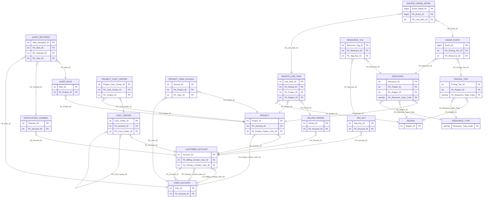

# Cloud Resource Management and Cost Optimization System

A MySQL database that tracks cloud resources, metered usage, budgets, cost center chargeback, invoices, and budget alerts for multiple customer organizations. It includes the full schema, synthetic sample data, a five-step use case walkthrough, reporting queries used for Tableau dashboards, and a script that benchmarks index performance on 2 million usage events.

**Tech:** MySQL 8.0, SQL (joins, window functions, CASE logic, triggers), MySQL Workbench, Tableau

**Live dashboard:** [Cloud Cost Optimization on Tableau Public](https://public.tableau.com/app/profile/rabiat.blessing.ibrahim/viz/CloudCostOptimizationDashboard_17918460822610/CloudCostOptimization)

## The problem

Teams that run workloads in the cloud often can't answer simple cost questions quickly: which customer is closest to its budget, which department should be charged for what, which resources cost the most this month, and whether an invoice matches what was actually used. This database models those questions directly, so each one becomes a single query.

## Schema at a glance

| Item | Count |
| --- | --- |
| Tables | 19 |
| Foreign keys | 32 (17 ON DELETE CASCADE, 12 RESTRICT, 3 SET NULL) |
| ENUM columns for fixed value sets | 12 |
| Named CHECK constraints | 10 |

The tables fall into five groups:

| Group | Tables |
| --- | --- |
| Core | CUSTOMER_ACCOUNT, USER_ACCOUNT, PROJECT, RESOURCE, USAGE_EVENT |
| Access and cost allocation | PROJECT_USER_ACCESS, COST_CENTER, PROJECT_COST_CENTER |
| Pricing and billing | PRICING_TIER, BILLING_PERIOD, INVOICE_LINE_ITEM, INVOICE_USAGE_DETAIL |
| Alerting | ALERT_RULE, NOTIFICATION_CHANNEL, ALERT_RECIPIENT |
| Reference data and tagging | RESOURCE_TYPE, REGION, TAG_KEY, RESOURCE_TAG |

### Key design decisions

- **CUSTOMER_ACCOUNT is the root of every tenant.** Users, projects, cost centers, tag standards, notification channels, and billing periods all belong to one account, which keeps each customer's data separate.
- **ENUMs for fixed values, lookup tables for growing lists.** Status, tier, and role fields use ENUM because their values never change. Resource types and regions live in their own tables because new ones get added over time.
- **Delete rules protect the audit trail.** Deleting a project cascades to its resources, but USAGE_EVENT uses RESTRICT on its resource, so a resource with billing history can't be deleted.
- **CHECK constraints enforce business rules in the database.** Budgets, spend, costs, rates, and quantities can't be negative, cost allocations must be between 0 and 100 percent, and end dates can't come before start dates.
- **USAGE_EVENT is indexed for its two most common lookups.** `idx_usage_timestamp` serves monthly reports, and the composite `idx_usage_resource (FK_Resource_ID, Event_Timestamp)` serves per-resource cost history.
- **A trigger keeps project spend current.** Each new usage event adds its cost to the owning project's `Current_Month_Spend`, so budget alerts respond to actual consumption.

### Entity relationship diagram

All 19 tables with their primary and foreign keys:



The core cost flow (project, resource, usage, pricing, region, resource type) with full column detail is in [docs/core_cost_flow_erd.png](docs/core_cost_flow_erd.png).

## Repository layout

```
cloud-cost-optimization-db/
├── README.md
├── data/
│   └── tableau_dashboard_data.xlsx  Query results behind the Tableau dashboard
├── docs/
│   └── core_cost_flow_erd.png
└── sql/
    ├── 01_schema_and_seed.sql       Full schema and sample data (resets the database)
    ├── 02_spend_trigger.sql         Trigger that updates project spend from usage
    ├── 03_use_case_walkthrough.sql  Five-step user journey
    ├── 04_analytics_queries.sql     Dashboard, scorecard, and reconciliation queries
    ├── 05_index_benchmark.sql       Index benchmark on 2,000,000 synthetic events
    └── 06_covering_index_test.sql   Covering index follow-up for the monthly report
```

## How to run

Requires MySQL 8.0.18 or later (the benchmark scripts use `EXPLAIN ANALYZE`).

```bash
mysql -u root -p < sql/01_schema_and_seed.sql
mysql -u root -p < sql/02_spend_trigger.sql
mysql -u root -p < sql/03_use_case_walkthrough.sql
mysql -u root -p < sql/04_analytics_queries.sql
mysql -u root -p < sql/05_index_benchmark.sql
mysql -u root -p < sql/06_covering_index_test.sql
```

In MySQL Workbench, open each file in the same order and run it with the lightning bolt icon. Run `03_use_case_walkthrough.sql` only once per fresh load, because each run inserts a new project. Running `01_schema_and_seed.sql` again resets everything, including the trigger, so run `02` again after a reset.

## Sample data

All data is synthetic. The companies, people, and email addresses are fictional.

| Entity | Rows |
| --- | --- |
| Customer accounts | 6 |
| Users | 18 |
| Projects | 15 |
| Resources | 22 |
| Usage events | 21 (November 2024) |
| Cost centers | 11 |
| Pricing tiers | 16 |
| Billing periods / invoice line items | 8 / 18 |

## Use case walkthrough

`03_use_case_walkthrough.sql` follows one project from creation to cost savings. Each step writes data and then checks the result with a multi-table query.

| Step | What happens | Tables joined |
| --- | --- | --- |
| 1. Project setup | Create the E-Commerce Platform project with a $50,000 budget and grant the owner access | 4 |
| 2. Resource provisioning | Deploy an RDS MySQL database, apply the three required tags, and run a tag compliance check | 6 |
| 3. Cost monitoring | Record 24 hours of database usage ($2.76 at $0.115/hour) and review project costs | 5 |
| 4. Budget alert | Set an 80% budget alert with two recipients and check whether it has triggered | 5 |
| 5. Optimization | Stop the database and estimate the monthly savings from its average daily cost | 4 |

## Analytics queries

`04_analytics_queries.sql` holds the queries behind the [Tableau dashboard](#dashboards), plus three scorecards and a reconciliation check. Results below come from running it right after `01` and `02`. Running the walkthrough first adds one project to Acme Corporation, which changes Query 1.

### Query 1: Executive spending overview

Budget, spend, and utilization by customer across active projects.

| Company | Projects | Budget | Spend | Utilization |
| --- | --- | --- | --- | --- |
| FinTech Dynamics | 3 | $147,000.00 | $57,700.00 | 39.3% |
| Global Retail Ltd | 3 | $100,000.00 | $39,600.00 | 39.6% |
| Acme Corporation | 4 | $120,000.00 | $39,201.25 | 32.7% |
| Cloud Innovations | 1 | $60,000.00 | $22,000.00 | 36.7% |
| DataDrive Solutions | 2 | $46,000.00 | $18,000.00 | 39.1% |
| TechStart Inc | 2 | $50,000.00 | $17,300.00 | 34.6% |

### Query 2: Cost center allocation

A five-table join that splits metered usage cost across departments using each project's allocation percentage. E-Commerce Platform is split 60/40 between Backend and Frontend Development.

| Department | Projects | Allocated cost |
| --- | --- | --- |
| Backend Development | 1 | $32.58 |
| Frontend Development | 1 | $21.72 |
| Product Development | 1 | $12.11 |
| Payment Systems | 1 | $7.37 |
| Data Science | 1 | $5.38 |

### Query 3: Top cost-consuming resources

Each resource's share of total spend for the reporting month, using a window function (`SUM(SUM(cost)) OVER ()`). Top five of 13 metered resources for November 2024 ($99.55 total):

| Resource | Type | Month cost | % of total |
| --- | --- | --- | --- |
| ecommerce-product-images | S3 Standard Storage | $34.50 | 34.7% |
| mobile-app-assets | S3 Standard Storage | $18.40 | 18.5% |
| ecommerce-web-server-01 | EC2 M5 Large Instance | $11.52 | 11.6% |
| customer-auth-function | Lambda Function Invocation | $8.35 | 8.4% |
| ecommerce-db-primary | RDS MySQL Database | $8.28 | 8.3% |

Two storage buckets account for over half of the month's metered cost, so storage lifecycle rules would be the first place to look for savings.

### Scorecards

- **Budget alert status:** labels each project HEALTHY, WARNING (75%+), CRITICAL (90%+), or OVER BUDGET.
- **Resource category spending:** each category's share of a company's total, using `OVER (PARTITION BY company)`.
- **Project performance:** resources, budget used, cost per resource, and a health rating for each active project.

### Invoice reconciliation check

Compares each invoice line item with the usage events linked to it. On the sample data, 15 of 18 line items have no linked usage, and the 3 that do are flagged as mismatches. For example, the November E-Commerce Platform line bills $9,800.75 while its 7 linked events total $49.69. The invoice amounts in the sample data were entered by hand rather than built from metering, and this check catches exactly that kind of gap before an invoice goes out.

## Dashboards

The three main queries feed an interactive Tableau dashboard: **[view it on Tableau Public](https://public.tableau.com/app/profile/rabiat.blessing.ibrahim/viz/CloudCostOptimizationDashboard_17918460822610/CloudCostOptimization)**.

| Dashboard | Source query | What it shows |
| --- | --- | --- |
| Executive Spending Overview | Query 1 | Budget vs. spend for each customer |
| Cost Center Allocation | Query 2 | Metered cost charged back to each department |
| Top Cost Resources | Query 3 | Each resource's share of November 2024 spend, colored by category |

The dashboard data is in [data/tableau_dashboard_data.xlsx](data/tableau_dashboard_data.xlsx), one sheet per query, taken from a fresh load of the sample data.

## Index benchmark

The sample data has only 21 usage events, too few to show any difference from indexing. `05_index_benchmark.sql` builds a separate table with 2,000,000 synthetic usage events spread over 24 months and the 22 seeded resources. It times two queries with `EXPLAIN ANALYZE`, first with no secondary indexes and then after adding the same two indexes USAGE_EVENT uses:

- **Query A:** top cost resources for one month (82,080 matching rows)
- **Query B:** one resource's cost for one month (3,730 matching rows)

The benchmark table has no foreign keys, so InnoDB doesn't create an automatic index on `FK_Resource_ID`, and the first runs are a true no-index baseline. Rows are generated from fixed formulas, so every run produces the same data.

### Results

Run on MySQL 8.0.44 (Windows), 2,000,000 rows loaded in 32.8 seconds. Indexed times are the actual times reported by `EXPLAIN ANALYZE`. No-index times are MySQL Workbench durations for the same `EXPLAIN ANALYZE` statements.

| Query | Matching rows | No index | Composite + timestamp indexes | Plus covering index |
| --- | --- | --- | --- | --- |
| B: one resource, one month | 3,730 | 1.531 s | 0.023 s | 0.031 s (same plan) |
| A: all resources, one month | 82,080 | 2.156 s | 2.008 s | 0.232 s |

Query B ended up about 65x faster and Query A about 9x faster than with no indexes.

**What this shows**

- **Query B:** the composite index `(FK_Resource_ID, Event_Timestamp)` lets MySQL jump straight to one resource's rows for the month instead of scanning all 2 million. The plan shows an index range scan on `idx_bench_resource` returning exactly the 3,730 matching rows. This is the lookup pattern behind per-resource cost history and the Step 3 cost review.
- **Query A, timestamp index only:** MySQL used `idx_bench_timestamp`, but the range scan alone took 1.68 of the 2.01 seconds. Each of the 82,080 index entries (about 4% of the table) needed a separate lookup into the table to read its cost, which costs about as much as reading the whole table.
- **Query A, covering index:** `idx_bench_covering (Event_Timestamp, FK_Resource_ID, Calculated_Cost)` holds every column the query needs. The plan switches to a "covering index range scan", and the scan of all 82,080 rows drops to 49 ms because no table lookups are needed.
- **Query B kept its plan** after the covering index was added. The optimizer still chose `idx_bench_resource`, so adding an index for one query did not hurt the other.

**The cost of the indexes**

| Index | Size on disk |
| --- | --- |
| PRIMARY (the table rows) | 149.7 MB |
| idx_bench_covering | 61.6 MB |
| idx_bench_resource | 47.6 MB |
| idx_bench_timestamp | 38.6 MB |

The three secondary indexes take about 148 MB, roughly as much space as the table itself, and each one adds work to every insert. With the covering index in place, `idx_bench_timestamp` is redundant, because the covering index starts with the same column and serves the same range scans. A production version would drop it and keep two indexes.

**A note on timing variation.** The first runs right after adding the covering index were slower (0.63 s for Query A and 0.41 s for Query B in Workbench). The likely cause is memory: MySQL's default buffer pool is 128 MB, smaller than the table plus its indexes (about 298 MB), so the first runs read index pages from disk. Repeat runs settled at the times above.

## Limitations

- The data is synthetic and small. It shows the design and query logic, not real spending patterns.
- `Current_Month_Spend` starts from seeded values. The trigger adds new usage on top of them, but there is no monthly reset job.
- Invoice line items in the sample data don't come from usage events, as the reconciliation check shows. A production version would generate line items from metered usage.

## Author

Rabiat Blessing Ibrahim, MPS in Analytics (Applied Machine Intelligence), Northeastern University, Vancouver
